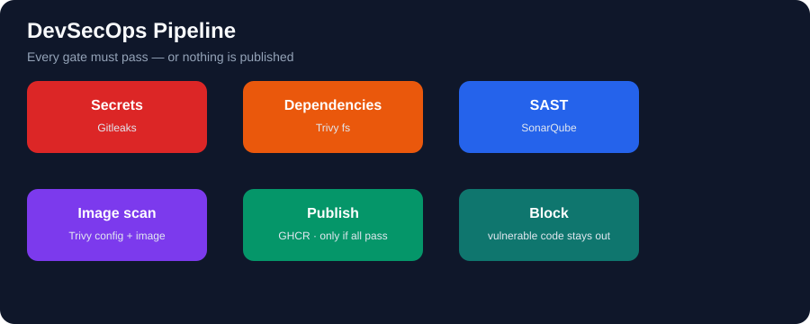
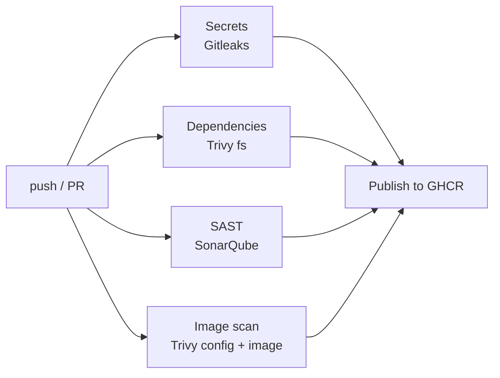

<div align="center">

# 🛡️ DevSecOps Pipeline

**Vulnerable code never gets published. Every gate must pass first.**


*GitHub Actions · Gitleaks · Trivy · SonarQube · Docker · GHCR*

</div>

---

## 🎯 What this does

A GitHub Actions pipeline that **blocks vulnerable code and containers from being published**. Nothing reaches GHCR unless every security gate passes.

## 🖼️ Architecture





📸 **Screenshots:** the architecture diagram above is the visual reference for this repo. A real GitHub Actions run / SonarQube screenshot can be added later from a live run — save it as `docs/screenshots/actions-run.png` and it will show here. No fake screenshots are included.

## 🚦 Gates

| Job | Tool | Fails the build when |
|---|---|---|
| secrets-scan | Gitleaks | Any secret exists in the git history |
| dependency-scan | Trivy (fs) | A fixable CRITICAL vulnerability exists in dependencies |
| sast | SonarQube | The quality gate fails |
| image-scan | Trivy (config, image) | HIGH misconfiguration in the Dockerfile, or a fixable CRITICAL CVE in the image |
| publish | Docker, GHCR | Never runs unless all four jobs above pass |

## ⚙️ Setup

1. Start SonarQube: `SONAR_DB_PASSWORD=<redacted>
2. In SonarQube create a project with key `devsecops-pipeline` and generate a token.
3. In GitHub, add repository secrets `SONAR_TOKEN` and `SONAR_HOST_URL`.
4. In GitHub, enable branch protection on `main` and require all four jobs to pass.

> **No SonarQube server yet?** The SAST job skips itself when the `SONAR_TOKEN` / `SONAR_HOST_URL` secrets are not set, so the workflow stays green — the other gates still run, and publish stays blocked until every gate that ran has passed. Add the secrets above and the next push will run SonarQube.

## 🧪 Prove each gate works

| Gate | Test |
|---|---|
| Gitleaks | Commit a line containing an AWS key pattern such as `AKIA` followed by 16 uppercase characters |
| Trivy dependencies | Pin an old vulnerable version in `app/requirements.txt` |
| SonarQube | Add an obvious vulnerability such as `eval(user_input)` |
| Trivy image | Change the base image to an old tag such as `python:3.8` |
| Dockerfile policy | Remove the `USER` line |

> ⚠️ These tests are for proving the gates in a throwaway branch — do not merge a real secret or a real vulnerability into `main`.

## 📂 Project layout

```
.
├── .github/workflows/devsecops.yml   # the 5-job pipeline
├── app/                              # demo Flask app + tests
├── Dockerfile                        # non-root, scanned by Trivy
├── .gitleaks.toml                    # secrets-scan config
├── sonar-project.properties          # SonarQube project config
└── docker-compose.sonarqube.yml      # local SonarQube
```
